# AdForge AI — Backend ERD

Generated from `prisma/schema.prisma`. 25 models across six domains — Identity, Content, Generation, Distribution, Billing, Platform.

Every table except `FeatureFlag` carries `organizationId` directly (straight multi-tenancy, no join-table indirection); `requireSession()` filters every query by it.

```mermaid
erDiagram
    USER ||--o{ MEMBERSHIP : "belongs via"
    ORGANIZATION ||--o{ MEMBERSHIP : "has members"
    ORGANIZATION ||--o{ PROJECT : owns
    USER ||--o{ PROJECT : creates
    ORGANIZATION ||--o{ BRAND_KIT : owns
    ORGANIZATION ||--o{ ASSET : owns
    PROJECT |o--o{ ASSET : "groups (opt)"
    PROJECT ||--o{ PRODUCT : contains
    PROJECT ||--o{ COPY_VARIANT : contains
    GENERATION |o--o{ COPY_VARIANT : "produced (opt)"
    ORGANIZATION ||--o{ GENERATION : requests
    PROJECT |o--o{ GENERATION : "scoped to (opt)"
    PRODUCT |o--o{ GENERATION : "about (opt)"
    USER ||--o{ GENERATION : requests
    ASSET |o--o{ GENERATION : "yields output (opt)"
    GENERATION ||--o{ VIDEO_SCENE : storyboards
    ORGANIZATION ||--o{ CAMPAIGN : runs
    PROJECT ||--o{ CAMPAIGN : contains
    USER ||--o{ CAMPAIGN : creates
    PRODUCT |o--o{ CAMPAIGN : "advertises (opt)"
    BRAND_KIT |o--o{ CAMPAIGN : "styles (opt)"
    AD_CONNECTION |o--o{ CAMPAIGN : "publishes via (opt)"
    CAMPAIGN ||--o{ CAMPAIGN_CREATIVE : contains
    ASSET ||--o{ CAMPAIGN_CREATIVE : "used as"
    CAMPAIGN_CREATIVE ||--o{ CREATIVE_METRIC : "tracks daily"
    CAMPAIGN ||--o{ CAMPAIGN_METRIC : "tracks daily"
    ORGANIZATION ||--o{ AD_CONNECTION : authorizes
    ORGANIZATION ||--o{ SUBSCRIPTION : subscribes
    ORGANIZATION ||--o{ INVOICE : billed
    ORGANIZATION ||--o{ CREDIT_TRANSACTION : ledgers
    ORGANIZATION ||--o{ USAGE_RECORD : meters
    ORGANIZATION |o--o{ AUDIT_LOG : "scoped to (opt)"
    USER |o--o{ AUDIT_LOG : "acts as (opt)"
    ORGANIZATION ||--o{ NOTIFICATION : receives
    USER |o--o{ NOTIFICATION : "addressed to (opt)"
    ORGANIZATION ||--o{ API_KEY : issues
    USER ||--o{ API_KEY : owns
    ORGANIZATION ||--o{ SUPPORT_TICKET : files
    USER ||--o{ SUPPORT_TICKET : opens
    ORGANIZATION ||--o{ ANALYTICS_INSIGHT : caches

    USER {
        string id PK
        string clerkId UK
        string email UK
        boolean isPlatformAdmin
    }
    ORGANIZATION {
        string id PK
        string clerkOrgId UK
        string name
        string slug UK
    }
    MEMBERSHIP {
        string id PK
        string userId FK
        string organizationId FK
        Role role
    }
    PROJECT {
        string id PK
        string organizationId FK
        string createdById FK
        ProjectStatus status
    }
    PRODUCT {
        string id PK
        string projectId FK
        string name
        Decimal price
    }
    BRAND_KIT {
        string id PK
        string organizationId FK
        boolean isDefault
    }
    ASSET {
        string id PK
        string organizationId FK
        string projectId FK
        AssetType type
        string storageKey UK
    }
    GENERATION {
        string id PK
        string organizationId FK
        string userId FK
        string provider
        string model
        GenerationStatus status
        int creditsCharged
    }
    COPY_VARIANT {
        string id PK
        string projectId FK
        string generationId FK
        CopyType type
        float score
    }
    VIDEO_SCENE {
        string id PK
        string generationId FK
        int position
        int durationMs
    }
    CAMPAIGN {
        string id PK
        string organizationId FK
        string projectId FK
        CampaignPlatform platform
        CampaignStatus status
        Decimal dailyBudget
    }
    CAMPAIGN_CREATIVE {
        string id PK
        string campaignId FK
        string assetId FK
        int position
    }
    CREATIVE_METRIC {
        string id PK
        string creativeId FK
        DateTime recordedAt
        Decimal spend
        Decimal revenue
    }
    CAMPAIGN_METRIC {
        string id PK
        string campaignId FK
        DateTime recordedAt
        Decimal spend
        Decimal revenue
    }
    AD_CONNECTION {
        string id PK
        string organizationId FK
        CampaignPlatform platform
        ConnectionStatus status
    }
    SUBSCRIPTION {
        string id PK
        string organizationId FK
        string stripeCustomerId UK
        SubscriptionStatus status
        int seats
    }
    INVOICE {
        string id PK
        string organizationId FK
        string stripeInvoiceId UK
        Decimal amountDue
        string status
    }
    CREDIT_TRANSACTION {
        string id PK
        string organizationId FK
        CreditType type
        int amount
        int balanceAfter
    }
    USAGE_RECORD {
        string id PK
        string organizationId FK
        string metric
        Decimal quantity
        int costCents
    }
    AUDIT_LOG {
        string id PK
        string organizationId FK
        string actorId FK
        string action
        string entityType
    }
    NOTIFICATION {
        string id PK
        string organizationId FK
        string userId FK
        NotificationType type
        DateTime readAt
    }
    API_KEY {
        string id PK
        string organizationId FK
        string userId FK
        string secretHash UK
        ApiKeyStatus status
    }
    FEATURE_FLAG {
        string id PK
        string key UK
        boolean enabled
    }
    SUPPORT_TICKET {
        string id PK
        string organizationId FK
        string userId FK
        TicketStatus status
        TicketPriority priority
    }
    ANALYTICS_INSIGHT {
        string id PK
        string organizationId FK
        string fingerprint
        DateTime expiresAt
    }
```

`||` = exactly one · `|o` = zero-or-one (nullable FK) · `o{` = zero-or-many. Timestamp columns (`createdAt`/`updatedAt`) and JSON blobs are omitted from the attribute lists above for legibility — see `prisma/schema.prisma` for the complete field set. `FeatureFlag` is the one table with no relations: a global, org-agnostic toggle.

## Domains

| Domain | Models |
|---|---|
| Identity | `User`, `Organization`, `Membership` |
| Content | `Project`, `Product`, `BrandKit`, `Asset` |
| Generation | `Generation`, `CopyVariant`, `VideoScene` |
| Distribution | `Campaign`, `CampaignCreative`, `CreativeMetric`, `CampaignMetric`, `AdConnection` |
| Billing | `Subscription`, `Invoice`, `CreditTransaction`, `UsageRecord` |
| Platform | `AuditLog`, `Notification`, `ApiKey`, `FeatureFlag`, `SupportTicket`, `AnalyticsInsight` |

## Structural patterns worth knowing

- **Multi-tenancy** — every table except `FeatureFlag` carries `organizationId` directly; no tenant scoping through a join. `requireSession()` filters every query by it.
- **Optional FKs → `SetNull`, not cascade** — relations marked `(opt)` above use `onDelete: SetNull`. Deleting a `Product` or `BrandKit` orphans its `Generation`/`Campaign` rows rather than deleting them.
- **Credit ledger is append-only** — `CreditTransaction` never updates a balance column; the current balance is the latest row's `balanceAfter`, read by `createdAt` descending (`src/server/credits.ts`).
- **Audit trail survives deletion** — `AuditLog.organizationId` and `.actorId` are both optional with `SetNull`, so a log entry outlives the org or user it recorded.
- **Metrics are dual-grained** — `CampaignMetric` rolls up per campaign per day; `CreativeMetric` does the same per individual creative. Both are unique on `(parentId, recordedAt)`.

---
*Generated from `prisma/schema.prisma`, 25 models.*
